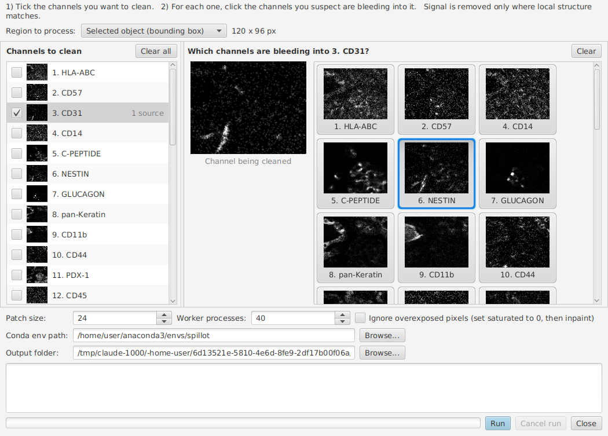

# SpillOT for QuPath

A QuPath extension that runs SpillOT spillover removal on the image open in QuPath.
It has the same workflow as the Fiji plugin and reuses its patch solver and
comparison algorithm. The memory-aware runner automatically processes tiles and
patch batches without holding all overlapping patches in RAM.

Requires **QuPath 0.7.0 or later**.



## Install

1. Create the `spillot` conda environment (same one the Fiji plugin uses):

   ```bash
   conda create -n spillot -c conda-forge python=3.11 numpy scipy tifffile imagecodecs
   ```

2. Download [qupath-extension-spillot-0.2.3.jar](../qupath-extension-spillot-0.2.3.jar),
   remove any older SpillOT extension jar, then drag the new jar onto the QuPath
   window and restart QuPath. Both Python runners are inside the jar; nothing
   else needs to be copied.

## Use

1. Open a multiplexed image (IMC, CODEX, Opal/Vectra, ...).
   For a whole-slide image, **draw and select an annotation** around the area you want to clean
   first. The selected object's bounding box is used. You can also choose the whole image.
2. **Extensions → SpillOT → Run SpillOT...**
3. On the left, tick the channels you want to clean. For each one, click the channels on the right
   that you suspect are bleeding into it. Signal is removed only where local structure matches.
4. Set the patch size (even, >= 4; default 24, smaller is faster and more aggressive), the number
   of worker processes, and the path to the `spillot` conda environment (prefilled when found).
5. Click **Run**. The window shows the current stage, progress and an estimated
   remaining time once enough work has completed to measure the processing rate.
   The estimate updates as the run proceeds; saving the result is a separate stage.

When the run finishes the cleaned image is added to the open project (or offered for opening in
the viewer if there is no project) with the original channel names and colours.

## Outputs

Written to the output folder (default: a `SpillOT` folder in the project or next to the image):

```text
<name>.tif                        exported region, one plane per channel
<name>.csv                        spillover matrix (row = target, column = source, 1 = remove)
<name>_Channel_<N>_SpillOT.tif    each cleaned channel
<name>_SpillOT.tif                full stack with the cleaned channels replaced
```

These are the same files and CSV convention as the Fiji plugin, so the exported `.tif` + `.csv`
pair can also be sent to a cluster and run with `plugins/SpillOT/SpillOT.py`.
If a `.csv` from an earlier run on the same region exists, the dialog is prefilled from it.
TIFF output includes channel names and pixel calibration;
large files use BigTIFF. A cropped region is still a new image with its own local
pixel coordinates; the source origin is retained in the output metadata.

## Notes

- Marker stacks saved as plain multi-page TIFFs open in QuPath as a z-stack or time series with one
  channel. The extension detects this (longest axis = markers, as in the Fiji plugin) and labels the
  markers `Ch1`, `Ch2`, ...; the result is saved as a proper multichannel image.
- For images with real z-slices or timepoints, the plane shown in the viewer is processed.
- RGB (brightfield) images are not supported.
- SpillOT supports unsigned 8-bit, unsigned 16-bit and 32-bit float
  images. Other source pixel types are rejected before export to avoid silently
  losing precision.
- The backend is CPU-only.

## Scripting

```groovy
import qupath.ext.spillot.SpillOT

def p = new SpillOT.Params()
p.envPath   = "/home/me/miniconda3/envs/spillot"
p.outputDir = java.nio.file.Paths.get("/data/spillot_out")
p.baseName  = "my_region"
// p.memoryBudgetMB = 1024         // optional backend budget; 0 = automatic
p.sources.put(20, [25, 27] as Set)   // 0-based: remove channels 26 and 28 from channel 21
// p.region = qupath.lib.regions.ImageRegion.createInstance(x, y, width, height, 0, 0)
def result = SpillOT.run(getCurrentServer(), p, { println it }, null, { false })
println result.fullStack
```

## Build from source

Needs a JDK 25 (the version QuPath 0.7 uses). From this folder:

```bash
./gradlew build
```

The jar is written to `build/libs/`. The build bundles `SpillOT.py` and
`SpillOTMemory.py` from `../plugins/SpillOT/`, so this folder must stay inside
the SpillOT repository.

## Tests

From the repository root, run the Python regression suite with an environment
containing NumPy, SciPy and tifffile:

```bash
python -m unittest discover -s tests -p 'test_spillot_low_memory.py'
```

From this folder, run `./gradlew test`. Set `SPILLOT_TEST_ENV` to the root of a
compatible conda environment to include the Java-to-Python integration tests:

```bash
SPILLOT_TEST_ENV=/path/to/envs/spillot ./gradlew test
```
